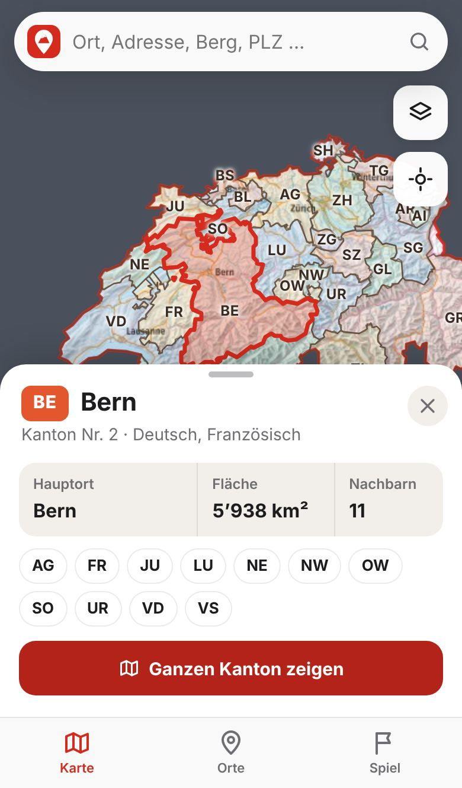
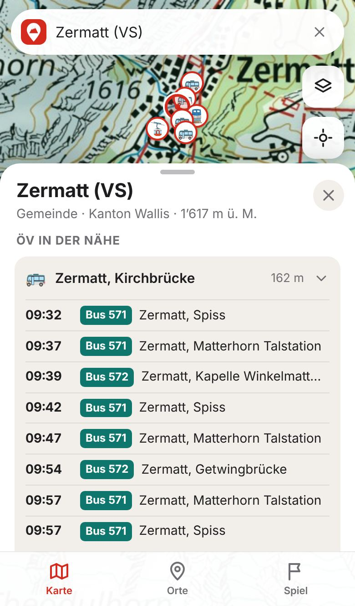
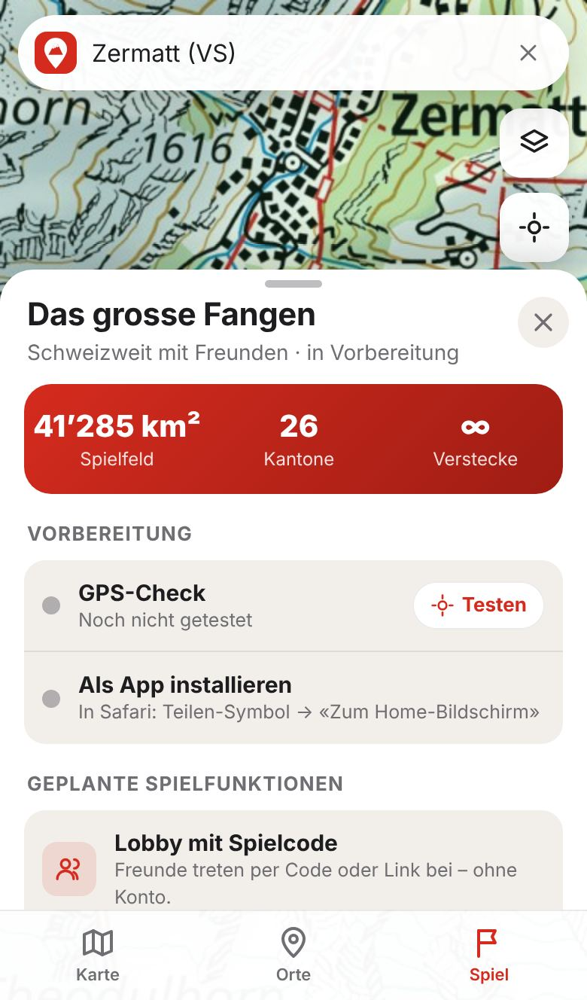

# SwissCatch – interaktive Schweizerkarte

Eine Karten-App für die ganze Schweiz, gebaut als installierbare Web-App (PWA).
Sie ist die Grundlage für ein späteres **schweizweites Fangen-Spiel mit Freunden**.

<p>
  
  
  
  
</p>

## Funktionen

- **Offizielle swisstopo-Karten:** Landeskarte, Grau, Luftbild (SWISSIMAGE) und Winterkarte.
- **Kantone:** farbige Grenzen und Namen. Antippen zeigt Hauptort, Fläche, Sprachen und Nachbarkantone.
- **Spielfeld Schweiz:** Das Ausland ist abgedunkelt, die Landesgrenze rot markiert.
- **Suche:** Orte, Adressen, Berge, Seen und Postleitzahlen über den Suchdienst von geo.admin.ch.
- **Punkt-Infos:** Lange drücken (am Computer Rechtsklick) zeigt Höhe, Kanton, Koordinaten (LV95 und GPS) und Distanz zu dir.
- **ÖV in der Nähe:** nächste Haltestellen mit Live-Abfahrten (Bahn, Bus, Tram, Seilbahn).
- **Eigener Standort:** Live-Position mit Genauigkeit, Folgen-Modus und Fahrtrichtung.
- **Pins:** Treffpunkte oder Verstecke speichern, benennen, einfärben, teilen. Sie bleiben auf dem Gerät gespeichert.
- **Zusatzebenen:** ÖV-Haltestellen und Wanderwege.
- **App-Gefühl:** Vollbild, Bottom-Sheets, Tab-Leiste, Dunkelmodus, installierbar, offline nutzbar für bereits geladene Kartenteile.

## Loslegen

Voraussetzung ist Node.js 20 oder neuer.

```bash
npm install
npm run dev        # Entwicklungsserver auf http://localhost:5173
npm run build      # Produktionsbuild in dist/
npm run preview    # Build lokal ansehen
```

Auf dem Handy im selben WLAN geht es mit `npm run dev -- --host`.
Der Standort funktioniert auf dem Handy aber nur über **HTTPS**, also am einfachsten über GitHub Pages.

## Veröffentlichen mit GitHub Pages

Der Workflow in `.github/workflows/deploy.yml` baut und veröffentlicht die App bei jedem Push auf `main`.
Er lässt sich auch von Hand im Tab «Actions» starten.

1. Im Repository unter **Settings → Pages** als Source **GitHub Actions** wählen.
2. Auf `main` pushen oder den Workflow «Deploy to GitHub Pages» manuell starten.
3. Die App ist danach unter `https://<benutzer>.github.io/App-Swisscatch/` erreichbar.
4. Auf dem Handy öffnen und zum Home-Bildschirm hinzufügen (iPhone: Teilen → «Zum Home-Bildschirm»).

## Aufbau

```
src/
  App.tsx                 Zustand der App, Sheets, Kartensteuerung
  components/
    MapView.tsx           Leaflet-Karte: Grundkarten, Kantone, Pins, Standort
    SearchBar.tsx         Ortssuche
    PlaceSheet.tsx        Infos zu einem Punkt, Pins, ÖV
    CantonSheet.tsx       Kantonsinfos
    PinsSheet.tsx         Liste «Meine Orte»
    GameSheet.tsx         Spiel-Tab (Vorbereitung, geplante Funktionen)
    LayerSheet.tsx        Grundkarte und Ebenen wählen
  hooks/                  Standort, Pins, Installation, Online-Status
  lib/
    config.ts             Kartenebenen und Grenzen
    geoadmin.ts           Suche und Höhenabfrage (api3.geo.admin.ch)
    transport.ts          Haltestellen und Abfahrten (transport.opendata.ch)
    geo.ts                Distanzen, LV95-Umrechnung, Punkt-in-Polygon
public/data/              Kantons- und Landesgrenzen als GeoJSON
scripts/build-geodata.mjs erzeugt public/data aus dem Paket swiss-maps
```

Die Kantonsdaten lassen sich mit `npm run geodata` neu erzeugen, etwa nach einer Gemeindefusion.

## Datenquellen

| Daten | Quelle | Bedingungen |
| --- | --- | --- |
| Karten, Luftbild, Höhen, Suche | [swisstopo / geo.admin.ch](https://www.geo.admin.ch) | Freie Nutzung mit Quellenangabe «© swisstopo» |
| ÖV-Haltestellen-Ebene | Bundesamt für Verkehr (BAV) | Freie Nutzung mit Quellenangabe |
| Abfahrten | [transport.opendata.ch](https://transport.opendata.ch) | Offene API, faire Nutzung |
| Kantonsgrenzen | BFS / swisstopo über [swiss-maps](https://github.com/interactivethings/swiss-maps) | BSD-3-Clause |

## Nächste Schritte zum Fangen-Spiel

Die App ist so gebaut, dass das Spiel als eigener Bereich dazukommen kann.

1. **Backend für Echtzeit:** Lobby mit Spielcode und Live-Standorte über einen Dienst wie Supabase oder Firebase.
2. **Spielregeln:** Rollen (Jäger und Gejagte), Spielzeit, Standort der Gejagten nur in Intervallen sichtbar.
3. **Zonen:** Spielfeld eingrenzen, Kantone sperren, schrumpfende Zonen. Die Kantonsdaten sind schon da.
4. **Fang bestätigen:** über Nähe-Check oder QR-Code.
5. **Standort im Hintergrund:** Web-Apps teilen den Standort nur, solange sie offen sind. Für echtes Hintergrund-Tracking lässt sich dieselbe App mit [Capacitor](https://capacitorjs.com) als native iOS- und Android-App verpacken.
