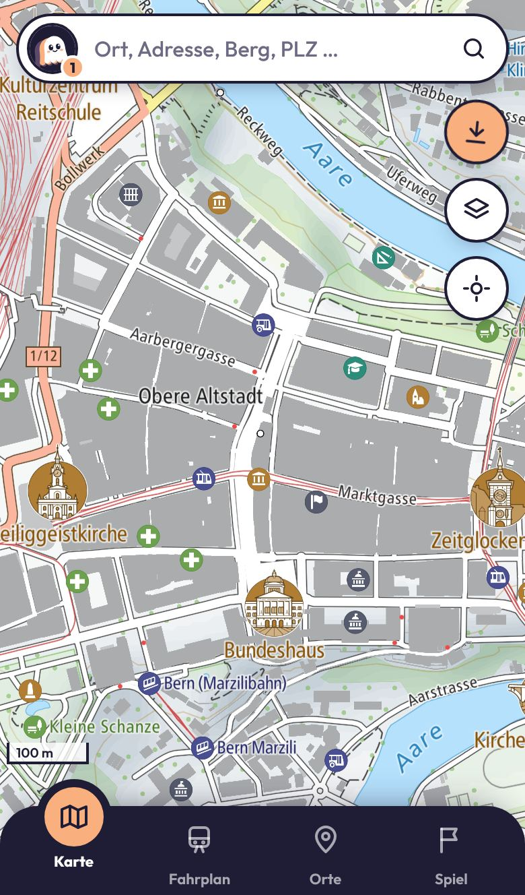
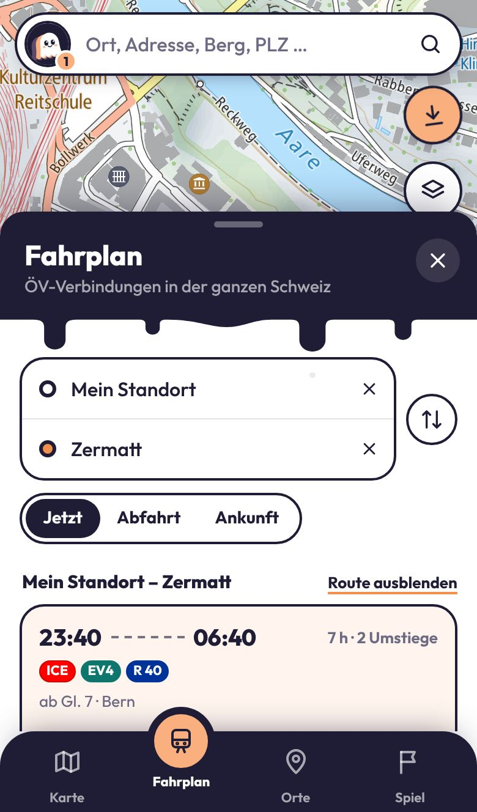
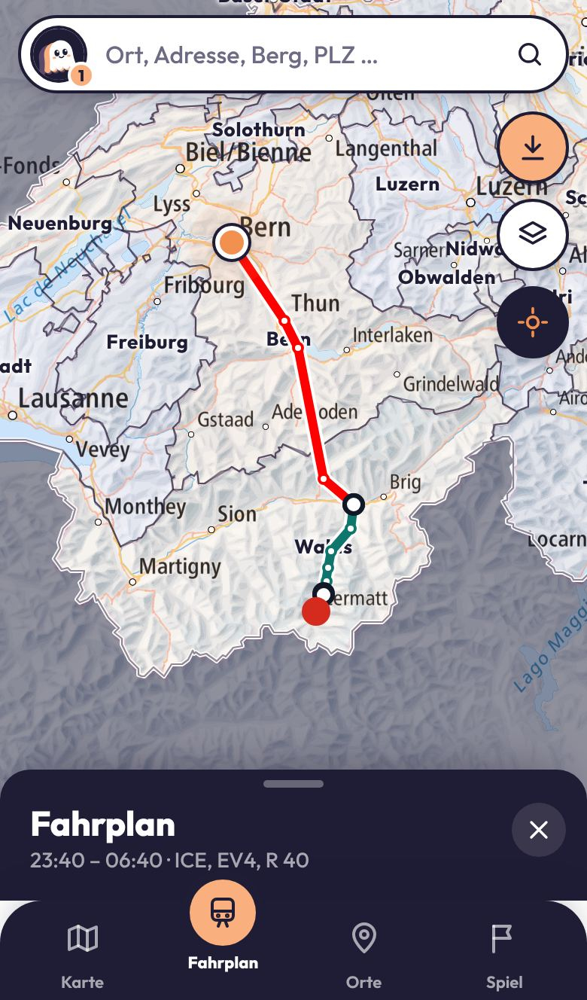
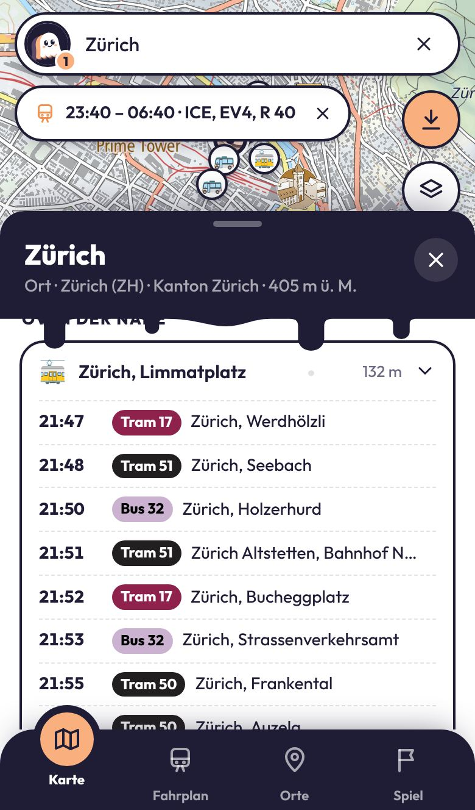
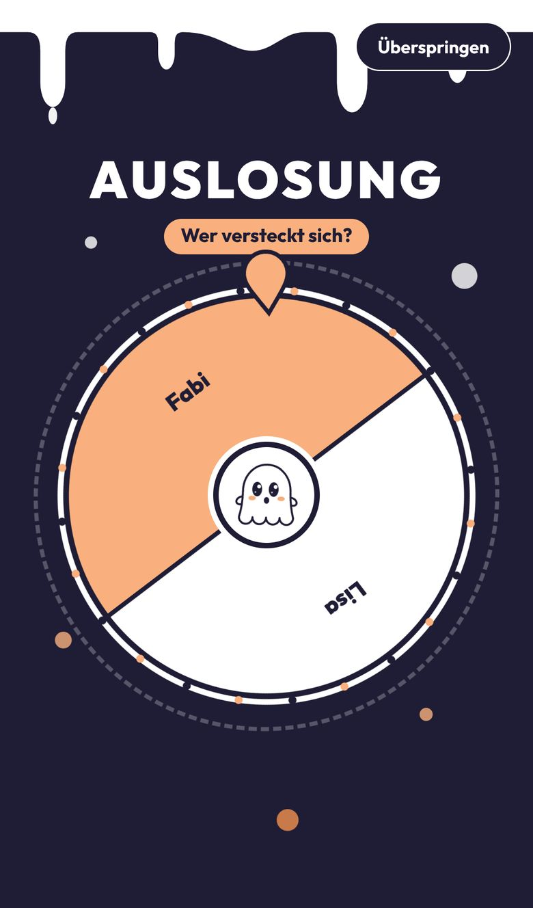
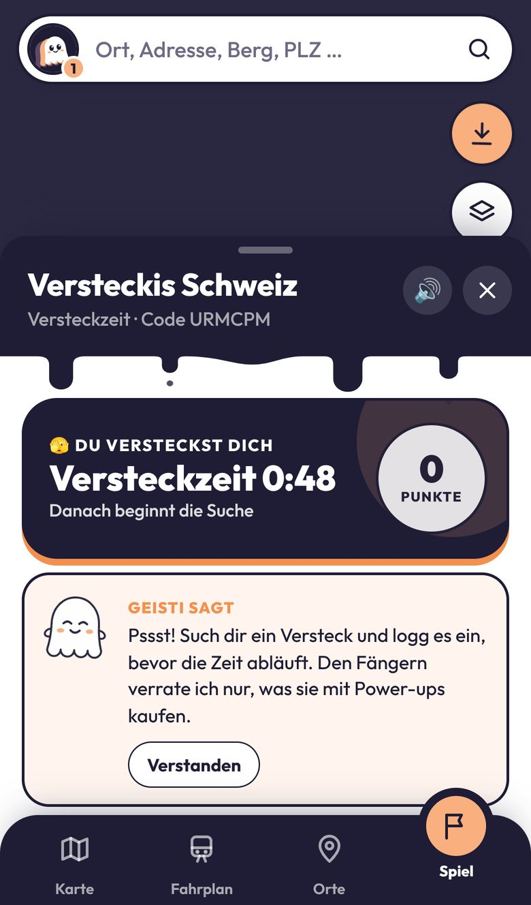
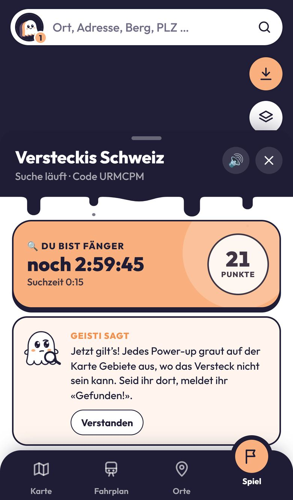
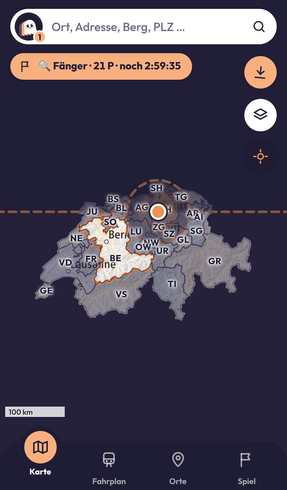

# Zeitgeist – das Versteckspiel quer durch die Schweiz

Eine Karten-App für die ganze Schweiz mit einem **schweizweiten Versteckspiel für Freunde**.
Sie läuft als installierbare Web-App (PWA) auf dem Handy und am PC, und als Android-App mit GPS im Hintergrund.

**Live:** https://ohfab.github.io/App-Swisscatch/ · **App herunterladen:** https://ohfab.github.io/App-Swisscatch/download/ · **Android-App:** [Zeitgeist.apk](https://github.com/ohfab/App-Swisscatch/releases/latest/download/Zeitgeist.apk)

<p>
  
  
  
  
</p>

<p>
  
  
  
  
  
</p>

## Funktionen

- **Das Spiel:** Lobby mit Spielcode, Glücksrad für die Teams, Versus-Screen, eigene Bildschirme für Fänger und Verstecker, Power-ups, Fallen, Challenges und Rätsel. Mehr dazu unten.

- **Strassenkarte im Google-Stil:** die Vektor-Basiskarte von swisstopo mit Strassennamen, Gebäuden, Haltestellen, ÖV-Linien und Sehenswürdigkeiten. Sie ist in jeder Zoomstufe scharf.
- **Weitere Karten:** Luftbild mit Strassennamen, klassische Landeskarte und Winterkarte.
- **Kantone:** farbige Grenzen und Namen. Antippen zeigt Hauptort, Fläche, Sprachen und Nachbarkantone.
- **Spielfeld Schweiz:** Das Ausland ist abgedunkelt, die Landesgrenze rot markiert.
- **Suche:** Orte, Adressen, Berge, Seen und Postleitzahlen über den Suchdienst von geo.admin.ch.
- **Punkt-Infos:** Lange drücken (am Computer Rechtsklick) zeigt Höhe, Kanton, Koordinaten (LV95 und GPS) und Distanz zu dir.
- **Fahrplan:** ÖV-Verbindungen von A nach B, ab dem eigenen Standort oder zu jedem Punkt auf der Karte. Mit Gleisen, Umstiegen, Verspätungen und der Route als Linie auf der Karte.
- **Abfahrten:** nächste Haltestellen mit Live-Abfahrten in den Originalfarben der Linien.
- **Eigener Standort:** Live-Position mit Genauigkeit, Folgen-Modus und Fahrtrichtung.
- **Pins:** Treffpunkte oder Verstecke speichern, benennen, einfärben, teilen. Sie bleiben auf dem Gerät gespeichert.
- **Zusatzebenen:** ÖV-Haltestellen und Wanderwege.
- **App-Gefühl:** Vollbild, Bottom-Sheets, Tab-Leiste, Dunkelmodus, installierbar, offline nutzbar für bereits geladene Kartenteile.
- **Design «Tinte & Pfirsich»:** klare Konturen, Pillen-Knöpfe, tropfende Kopfzeilen und viele kleine Animationen (springende Tab-Blase, gleitende Tabs, Glücksrad, Versus-Screen).
- **Geisti, das Maskottchen:** Der kleine Geist schwebt durch die ganze App, mit zehn Stimmungen von fröhlich bis traurig, Lupe für die Fänger und Partyhut bei Siegen. Mehr dazu unten.

## Geisti und dein Fortschritt

Geisti ist der Geist von Zeitgeist und begleitet dich wie der Vogel bei Duolingo.

- **Einführung:** Beim ersten Start stellt sich Geisti vor, fragt nach deinem Namen und worauf du Lust hast (Spiel, Schweiz erkunden oder Fahrplan), holt die Erlaubnis für Mitteilungen ab und bietet die App zum Installieren an. Er spricht in Sprechblasen, Buchstabe für Buchstabe.
- **Tour:** Danach zeigt er mit einem Spotlight die wichtigsten Stellen: Suche, Karte, Standort, Ebenen, Fahrplan, Orte, Spiel und Profil. Die Tour lässt sich im Profil jederzeit wiederholen.
- **Tipps im Spiel:** Je nach Rolle und Phase gibt Geisti einmalig einen kurzen Tipp, etwa «Logg dein Versteck ein» oder «Kauft Power-ups».
- **Reaktionen:** Er jubelt mit Partyhut, wenn du gewinnst, ist traurig bei einer Niederlage, versteckt sich (halb durchsichtig) bei den Versteckern und sucht mit der Lupe bei den Fängern.
- **Profil:** Ein Tipp auf das Logo oben links öffnet dein Profil, mit Level (vom «Nebelhauch» bis zum «Zeitgeist»), XP, Statistik, Geistis Fakt des Tages, Abzeichen und der Kantonssammlung.
- **Abzeichen:** 17 Abzeichen, z.B. «Spürnase» (als Fänger gewinnen), «Phantom» (als Verstecker gewinnen), «Kantönligeist» (in 5 Kantonen unterwegs), «Nachtgespenst» (Runde nach 22 Uhr) oder «Pendler» (10 Verbindungen gesucht). Neue Abzeichen feiert Geisti mit einer Meldung.
- **Kantone sammeln:** Jeder Kanton, in dem dein Standort an war, kommt in die Sammlung, bis alle 26 voll sind.

Fortschritt und Abzeichen bleiben auf dem Gerät gespeichert.

## Das Spiel

Die Hälfte der Gruppe versteckt sich irgendwo in der Schweiz, die andere Hälfte sucht sie, zum Beispiel mit dem Zug.

**Ablauf**

1. Eine Person öffnet den Tab «Spiel», tippt auf «Spiel erstellen» und teilt den Code oder den Einladungslink.
2. Die anderen treten bei. Der Host legt die Regeln fest: Spielerzahl, Versteckzeit, maximale Suchzeit, Abstand der Challenges, Punkte und Startguthaben der Fänger.
3. Ist die Lobby voll, dreht das **Glücksrad** und zieht die Verstecker, immer die Hälfte. Der Host kann auch früher auslosen.
4. Ein **Versus-Screen** zeigt die Teams, dann zählt die App 3-2-1 herunter.
5. **Versteckzeit** (Standard 90 Min): Die Verstecker reisen an ihren Ort und loggen ihr Versteck ein. Die Fänger warten, zum Beispiel im Café, und sammeln dabei schon Punkte. Ohne Login nimmt die App am Ende der Versteckzeit den aktuellen Standort.
   - Die App wartet beim Einloggen kurz auf eine genaue GPS-Messung und zeigt die Genauigkeit an.
   - Ist das GPS ungenau (oder am PC ohne GPS), lässt sich das Versteck **auf der Karte wählen**, innerhalb der GPS-Ungenauigkeit. Die Fänger sehen, dass es von Hand gesetzt wurde.
6. **Suche:** Die Fänger reisen los und kaufen Power-ups. Sind sie beim Versteck, tippen sie auf «Gefunden!». Liegt das Versteck höchstens 200 m entfernt, zählt es sofort, sonst bestätigen die Verstecker.
7. Die Fänger gewinnen, wenn sie das Versteck finden, die Verstecker, wenn die Suchzeit abläuft. Danach startet der Host eine neue Runde: neu auslosen oder Rollen tauschen.

**Fänger**

- Sie bekommen Punkte über die Zeit (Standard 1 P pro Minute), für jede verpasste Challenge der Verstecker und für gelöste Rätsel (alle 15 Min eines).
- Mit den Punkten kaufen sie Power-ups. Schwache sind billig, starke teuer. Die App beantwortet sie ehrlich mit den eingeloggten Daten des Verstecks und graut ausgeschlossene Gebiete auf der Karte aus.

| Power-up | Frage | Punkte |
| --- | --- | --- |
| Höhenmesser | Über oder unter 800 m ü. M.? | 15 |
| Höher oder tiefer? | Liegt das Versteck höher oder tiefer als du gerade? | 15 |
| Haltestellen-Check | Nächste ÖV-Haltestelle näher als 300 m? | 15 |
| Radar 2 km | Versteck im Umkreis von 2 km? | 20 |
| Einwohner | Gemeinde mit mehr oder weniger als 20'000 Einwohnern? | 20 |
| See oder Fluss | See oder grosser Fluss im Umkreis von 1 km? | 20 |
| Anfangsbuchstabe | Beginnt der Gemeindename mit A–M oder N–Z? | 25 |
| Thermometer | Mindestens 1 km gehen, dann messen: wärmer oder kälter? Die Karte graut die falsche Seite aus | 25 |
| Radar 10 km | Versteck im Umkreis von 10 km? | 30 |
| Karte halbieren Nord/Süd oder Ost/West | Die unmögliche Hälfte wird ausgegraut | 30 |
| Sprachregion | Welche Sprache spricht man am Versteck? | 35 |
| Gleiche Linie? | Hält eine ÖV-Linie deiner nächsten Haltestelle auch beim Versteck? | 35 |
| Radar 50 km | Versteck im Umkreis von 50 km? | 40 |
| Foto anfordern | Verstecker schicken innert 10 Min ein Foto | 45 |
| Kanton | In welchem Kanton liegt das Versteck? | 90 |

**Verstecker**

- Alle 10 Minuten kommt eine **Challenge**. Während der Versteckzeit sind es allgemeine Schweiz-Quizfragen, die nichts verraten, denn vielleicht sind die Verstecker noch unterwegs. In der Suchphase folgen Hinweise für die Fänger: Kirchen zählen, Sprache, Wasser oder Schneeberge in Sicht, Brunnen, ÖV-Linie, später auch der Kanton und Fotos von Strasse, Himmel oder einem Gebäude.
- Erfüllte Challenges und verlangte Fotos geben Punkte. Wer eine Challenge verpasst, schenkt den Fängern 15 Punkte.
- Mit den Punkten stellen sie **Fallen**:

| Falle | Wirkung | Punkte |
| --- | --- | --- |
| Preiserhöhung | Power-ups kosten 15 Min lang 50 % mehr | 25 |
| Nebel | Die nächste Power-up-Antwort kommt erst nach 10 Min | 30 |
| Tarnkappe | Die nächste Challenge fällt aus, ohne Strafpunkte | 30 |
| Punkteklau | Die Fänger verlieren sofort 30 Punkte | 35 |
| Funkstille | Die Fänger können 10 Min lang keine Power-ups kaufen | 40 |
| Stopp! | Die Fänger müssen 10 Min lang stehen bleiben | 45 |

**Weitere Funktionen**

- **Spielfeld:** Der Host kann das Spiel auf Kantone oder Grossregionen beschränken (z.B. «Espace Mittelland»). Ausserhalb ist die Karte abgedunkelt, und ein Versteck dort lässt sich nicht einloggen.
- **Chat:** In der Lobby schreiben alle zusammen, im Spiel nur das eigene Team. Dazu gibt es Schnellantworten wie «🚆 Bin im Zug».
- **Quiz und Rätsel:** Fragen zu Kantonen sowie Schätz- und Vergleichsfragen zu Bergen, Seen, Pässen, Tunneln und Städten.
- **Töne und Vibration:** Glücksrad, Countdown, Challenges, Fallen und Sieg haben eigene Töne. Sie lassen sich im Spiel-Menü mit 🔊 ausschalten.
- **Benachrichtigungen:** Ist die App im Hintergrund, melden sich neue Challenges, Fallen, Chat-Nachrichten und «Gefunden!» als Systembenachrichtigung. Die Erlaubnis holt die Lobby einmal ab.

**Fair Play:** Die App vertraut den Spielern. Sie zeigt jedem Team nur seine eigenen Informationen. Die Fänger sehen weder das Versteck noch die Standorte der Verstecker. Das Versteck erscheint erst am Ende der Runde.

**Technik:** Die Geräte tauschen sich über öffentliche MQTT-Broker aus, gleichzeitig über `broker.emqx.io` und `broker.hivemq.com`. Jede Nachricht geht an beide; fällt einer aus, läuft das Spiel über den anderen weiter, ohne Konto und ohne eigenen Server. Alle Nachrichten und Fotos sind mit einem Schlüssel aus dem Spielcode verschlüsselt (AES-GCM). Der Broker sieht deshalb weder Namen noch Standorte. Der Host verwaltet Regeln und Auslosung. Jedes Gerät schreibt nur seine eigenen Aktionen, den Spielstand rechnet jedes Gerät gleich daraus aus. Damit Glücksrad, Countdown und Challenges überall gleichzeitig laufen, gleichen alle Geräte ihre Uhr mit dem Host ab (wie bei NTP), auch wenn eine Geräteuhr ein paar Sekunden falsch geht. Verlässt der Host das Spiel, übernimmt automatisch der Spieler, der am längsten dabei ist.

**Eigener Broker:** Beim Build `VITE_MQTT_URL=wss://…` setzen oder die App einmal mit `?broker=wss://…` öffnen. Mehrere Broker durch Kommas trennen.

**Lokal testen:** `npm run broker` startet einen Broker auf `ws://127.0.0.1:1884`. Die App dann mit `?broker=ws://127.0.0.1:1884` öffnen. Mit der Versteckzeit «1 Min (Test)» und Challenges «jede Minute» lässt sich eine Runde in wenigen Minuten durchspielen.

## Am PC nutzen

Die App läuft auch im Browser am Computer, die Karte nutzt dann den ganzen Bildschirm, das Menü sitzt links.

1. https://ohfab.github.io/App-Swisscatch/download/ in Chrome oder Edge öffnen. Die Seite «App herunterladen» zeigt je nach Gerät den passenden Weg und einen QR-Code fürs Handy.
2. Auf «Jetzt installieren» klicken, oder auf das Installieren-Symbol rechts in der Adressleiste. In Edge geht es auch über das Menü «Apps → Diese Website als App installieren».
3. Die App startet danach in einem eigenen Fenster und erscheint im Startmenü bzw. im Dock.

Am PC ist der Standort meist ungenau (WLAN-Ortung). Zum Spielen unterwegs eignet sich deshalb das Handy.

## Android-App

Web-Apps senden den Standort nur, solange sie offen sind. Die Android-App läuft mit gesperrtem Bildschirm weiter: Während eines Spiels zeigt sie eine dauerhafte Meldung «Zeitgeist läuft» und schickt den Standort weiter an die Mitspieler. Challenges, Fallen und Chat kommen als Benachrichtigung.

- **Download:** [Zeitgeist.apk](https://github.com/ohfab/App-Swisscatch/releases/latest/download/Zeitgeist.apk), auch über die Seite «App herunterladen». Der alte Link `Spurlos.apk` liefert dieselbe Datei. Beim ersten Mal fragt Android, ob der Browser «unbekannte Apps» installieren darf.
- **Updates:** Neue Versionen einfach über die alte installieren, gespeicherte Pins und Einstellungen bleiben.
- **Build:** `.github/workflows/android.yml` baut die APK bei jedem Push und legt sie im Release `android-latest` ab. Lokal geht es mit `npm run android` (Java 21 und Android SDK nötig, `ANDROID_HOME` gesetzt).
- **Technik:** [Capacitor](https://capacitorjs.com) verpackt dieselbe Web-App (`VITE_NATIVE=1`, ohne Service Worker). Das Android-Projekt `android/` entsteht bei jedem Build neu; `scripts/android-prepare.mjs` legt Symbol, Startbild und Texte aus `native/android/res` darüber und setzt Version und Signatur. GPS im Hintergrund über `@capacitor-community/background-geolocation`, Benachrichtigungen über `@capacitor/local-notifications`.
- **Signatur:** Damit Updates sich drüber installieren lassen, braucht jede Version denselben Schlüssel. Er liegt in `native/android/spurlos.jks` (Passwort `spurlos-public`). Das ist für eine Freundes-App bequem, heisst aber: Jeder mit dem Repo könnte eine APK mit derselben Signatur bauen. Wer das nicht will, legt einen eigenen Schlüssel als GitHub-Secret an und gibt ihn dem Workflow über `ANDROID_KEYSTORE_FILE`, `ANDROID_KEYSTORE_PASSWORD`, `ANDROID_KEY_ALIAS` und `ANDROID_KEY_PASSWORD` mit. Danach muss die App einmal neu installiert werden.
- **iPhone:** Eine iOS-App bräuchte ein Apple-Entwicklerkonto. Auf dem iPhone läuft Zeitgeist als Web-App vom Home-Bildschirm.

## Loslegen

Voraussetzung ist Node.js 20 oder neuer.

```bash
npm install
npm run dev        # Entwicklungsserver auf http://localhost:5173
npm run build      # Produktionsbuild in dist/
npm run preview    # Build lokal ansehen
```

Auf dem Handy im selben WLAN geht es mit `npm run dev -- --host`.
Der Standort funktioniert auf dem Handy aber nur über **HTTPS**, also am einfachsten über GitHub Pages.

## Veröffentlichen mit GitHub Pages

Der Workflow in `.github/workflows/deploy.yml` baut und veröffentlicht die App bei jedem Push auf `main` oder auf den Entwicklungszweig `claude/interactive-swiss-map-app-ocuqhp`.
Er lässt sich auch von Hand im Tab «Actions» starten.

1. Im Repository unter **Settings → Pages** als Source **GitHub Actions** wählen.
2. Auf `main` pushen oder den Workflow «Deploy to GitHub Pages» manuell starten.
3. Die App ist danach unter `https://<benutzer>.github.io/App-Swisscatch/` erreichbar.
4. Auf dem Handy öffnen und zum Home-Bildschirm hinzufügen (iPhone: Teilen → «Zum Home-Bildschirm»).

## Aufbau

```
src/
  App.tsx                 Zustand der App, Sheets, Kartensteuerung
  styles/                 Design «Tinte & Pfirsich»: base (Farben, Schrift), map, shell, content, game, show, desktop
  components/
    Art.tsx               Grafiken: tropfende Kanten und Geisti (Stimmungen, Lupe, Partyhut)
    Geisti.tsx            Geisti spricht: Sprechblase, Tipps im Spiel, Abzeichen-Meldung
    Onboarding.tsx        Einführung mit Geisti (Name, Ziel, Mitteilungen, App)
    Tour.tsx              Tour durch die App mit Spotlight
    ProfileSheet.tsx      Profil: Level, Statistik, Abzeichen, Kantone, Einstellungen
    MapView.tsx           Leaflet-Karte mit MapLibre-Vektorkarte, Kantone, Pins, Route, Standort
    SearchBar.tsx         Ortssuche
    PlaceSheet.tsx        Infos zu einem Punkt, Pins, ÖV
    CantonSheet.tsx       Kantonsinfos
    PinsSheet.tsx         Liste «Meine Orte»
    RouteSheet.tsx        Fahrplan: Verbindungssuche von A nach B
    GameSheet.tsx         Spiel-Tab: Start, Lobby, Regeln, Ergebnis
    game/DrawShow.tsx     Glücksrad, Versus-Screen und Countdown
    game/TeamViews.tsx    Bildschirme der Fänger und der Verstecker
    game/common.tsx       Bausteine: Punkte, Feed, Fotos, Tabs
    LayerSheet.tsx        Grundkarte und Ebenen wählen
  game/
    client.ts             Verbindung zum Broker, Lobby, Auslosung, Aktionen
    derive.ts             berechnet aus allen Aktionen den Spielstand
    content.ts            Power-ups, Fallen, Challenges, Quiz und Rätsel
    facts.ts              Fakten zum Versteck (Gemeinde, Einwohner, Höhe …)
    crypto.ts             Verschlüsselung mit dem Spielcode
  hooks/                  Standort (im Browser und in der Android-App), Pins, Installation, Online-Status
  lib/
    config.ts             Kartenebenen und Grenzen
    geoadmin.ts           Suche und Höhenabfrage (api3.geo.admin.ch)
    transport.ts          Haltestellen, Abfahrten und Verbindungen (search.ch)
    geo.ts                Distanzen, LV95-Umrechnung, Punkt-in-Polygon
    notify.ts             Systembenachrichtigungen (Browser und Android)
    sound.ts              Spieltöne, im Browser erzeugt
    native.ts             Erkennung der Android-App, öffentliche Adressen
public/data/              Kantons- und Landesgrenzen als GeoJSON
native/android/           Symbol, Startbild, Texte und Schlüssel der Android-App
capacitor.config.ts       Einstellungen der Android-App
scripts/build-geodata.mjs erzeugt public/data aus dem Paket swiss-maps
scripts/android-prepare.mjs passt das erzeugte Android-Projekt an
```

Die Kantonsdaten lassen sich mit `npm run geodata` neu erzeugen, etwa nach einer Gemeindefusion.

## Datenquellen

| Daten | Quelle | Bedingungen |
| --- | --- | --- |
| Karten, Vektorkarte, Luftbild, Höhen, Suche | [swisstopo / geo.admin.ch](https://www.geo.admin.ch) | Freie Nutzung mit Quellenangabe «© swisstopo» |
| ÖV-Haltestellen-Ebene | Bundesamt für Verkehr (BAV) | Freie Nutzung mit Quellenangabe |
| Fahrplan und Abfahrten | [search.ch](https://search.ch/timetable/api/help) | Gratis, pro Tag 1000 Verbindungssuchen und 10'080 Abfahrtstafeln |
| Kantonsgrenzen | BFS / swisstopo über [swiss-maps](https://github.com/interactivethings/swiss-maps) | BSD-3-Clause |
| Gemeinde am Versteck | swisstopo, Gemeindegrenzen über api3.geo.admin.ch | Freie Nutzung mit Quellenangabe |
| Einwohnerzahl und Amtssprache der Gemeinde | [Wikidata](https://www.wikidata.org) | CC0 |
| Schrift Outfit | [Google Fonts](https://fonts.google.com/specimen/Outfit) über Fontsource | SIL Open Font License |
| Spiel-Nachrichten | [EMQX Public Broker](https://www.emqx.com/en/mqtt/public-mqtt5-broker) und [HiveMQ Public Broker](https://www.hivemq.com/mqtt/public-mqtt-broker/) | Gratis Testbroker ohne Garantie, parallel genutzt; Inhalte verschlüsselt |

## Nächste Schritte

1. **iPhone-App:** Mit einem Apple-Entwicklerkonto liesse sich dieselbe Capacitor-App auch für iOS bauen, mit Standort im Hintergrund.
2. **Eigener Broker:** Für noch mehr Verlässlichkeit ein eigener, kostenloser Cloud-Broker (z.B. HiveMQ Cloud oder EMQX Serverless) zusätzlich zu den öffentlichen.
3. **Minigames:** weitere Wege zu Punkten für beide Teams, z.B. Fahrplan-Aufgaben unterwegs.
4. **Mehr Fallen:** z.B. eine Falle, die eine Fänger-Frage falsch beantwortet.
